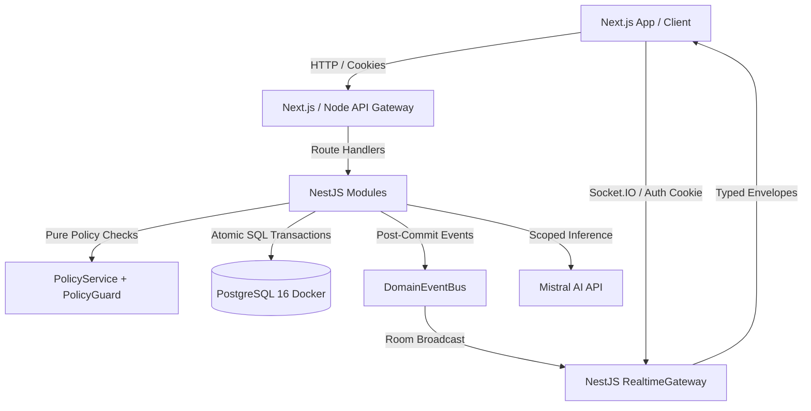

# FORGELINE — System Architecture Document
Last updated: 2026-10-10 (v1.0 Release)

---

## 1. Executive Summary & Philosophy
**Forgeline** is an enterprise-grade collaborative project management platform built for high-stakes operational environments. The architecture is guided by three non-negotiable pillars:
1. **Zero-Trust Server Authorization:** Permissions are never trusted from client payloads. Every access decision is deterministically evaluated on the backend via a pure `PolicyService`.
2. **Absolute Data Consistency:** Concurrency conflicts are prevented at the SQL execution layer using integer versioning and atomic update predicates, returning structured HTTP 409 envelopes with interactive client resolution.
3. **Transactional Real-Time Sync:** Socket.IO events are emitted exclusively *post-commit* from Prisma transactions, ensuring zero phantom events or race conditions.



---

## 2. Real-Time Architecture & Socket.IO Approach

### 2.1 Why Socket.IO over Raw WebSockets?
1. **Transport Fallback & Reconnection Reliability:** Automatic WebSocket to HTTP Long-Polling fallback ensures reliable connections across restrictive firewalls, corporate proxies, and mobile cellular handoffs.
2. **Built-in Room Scoping:** High-performance, memory-efficient room abstractions (`project:{id}` and `user:{id}`) without requiring custom subscription protocol parsers.
3. **Heartbeat & Presence Management:** In-memory presence map with ~20s heartbeats and automatic TTL eviction cleans up crashed clients without orphaned records.

### 2.2 Room Scoping & Post-Commit Emission
- **Connection Handshake:** Authenticated strictly via HTTP-only `access_token` cookie. Expired or forged cookies are rejected before socket establishment.
- **Auto-Join:** Upon connection, every socket automatically joins `user:{userId}` for direct user notifications and session-severing events (`user.deactivated`).
- **Project Scoping:** Emitting `project.join { projectId }` evaluates server-side project membership via `PolicyService`. Non-members are rejected.
- **Domain Event Bus:** All database mutations execute in a transaction. Realtime domain events are placed on an in-memory `DomainEventBus` that fires *only* after `prisma.$transaction` successfully commits.

### 2.3 Client Cache Patching vs. Invalidation
Rather than triggering expensive re-fetches for every minor change, client event handlers patch TanStack Query caches directly in place:
- **Version Guard:** Events carry the entity's new `version`. The client ignores any event whose version is `<= cached.version`, guaranteeing monotonicity even during network out-of-order delivery.
- **Visual Flourishes:** Moves trigger a neon ice-coloured trace highlight on the modified card, accompanied by a subtle device haptic (`navigator.vibrate(12)`).

---

## 3. Data Model & Storage

### 3.1 Relational Architecture (PostgreSQL 16)
- **Users (`users`):** Case-insensitive email via PostgreSQL `citext`, Argon2id password hash, `global_role` enum (`ADMIN`, `PROJECT_MANAGER`, `TEAM_MEMBER`, `VIEWER`), `token_version` counter for instant multi-device revocation.
- **Projects (`projects`):** UUID primary key, uppercase project `key` (e.g. `HLX`), `version` integer for optimistic locking, status (`ACTIVE`, `ARCHIVED`).
- **Project Members (`project_members`):** Composite primary key `(project_id, user_id)` with `project_role` (`MANAGER`, `MEMBER`, `VIEWER`).
- **Tasks (`tasks`):** Scoped contiguous `number` per project (e.g. `HLX-12`), status (`BACKLOG`, `TODO`, `IN_PROGRESS`, `IN_REVIEW`, `DONE`), priority (`LOW`, `MEDIUM`, `HIGH`, `URGENT`), integer `version` (starts at 1).
- **Comments (`comments`):** Scoped to task and project, with @mention parsing.
- **Activity Logs (`activity_logs`):** Append-only audit trail capturing `userId`, `projectId`, `action`, `entityType`, `entityId`, and JSON metadata.
- **Notifications (`notifications`):** Recipient-isolated notifications with `read_at` timestamp.

---

## 4. Authorization & Security Model

### 4.1 Dual-Tier Hierarchy & Rule of Cap
Authorization evaluates both Global Role and Project Role through a single deterministic truth table:
```
Effective Capability = Math.min(GlobalRoleCapability, ProjectRoleCapability)
```
- **Rule of Cap:** A user with global `VIEWER` role can NEVER perform mutations, even if mistakenly assigned `MANAGER` in a specific project.
- **Admin Bypass:** Global `ADMIN` holds authoritative access across all sectors and audit tables.
- **Pure Function:** `PolicyService.can(globalRole, projectRole, permission, context)` has zero database dependencies, enabling exhaustive unit test matrices with zero I/O overhead.
- **Server Guard Enforcement:** All routes protected by `@RequirePermission(...)` run through NestJS `PolicyGuard` before entering controller handlers.

---

## 5. Optimistic Concurrency Control

### 5.1 The Concurrency Hazard
In collaborative operations, multiple users frequently adjust tasks simultaneously. Last-write-wins creates catastrophic silent data corruption.

### 5.2 Atomic Predicate Pattern
Every update operation includes the expected integer `version`:
```sql
UPDATE tasks
SET title = $1, status = $2, version = version + 1, updated_at = NOW()
WHERE id = $3 AND version = $4
RETURNING *;
```
If another transaction updated the record first, the predicate matches 0 rows. The service detects 0 affected rows and immediately returns:
```json
{
  "statusCode": 409,
  "error": {
    "code": "VERSION_CONFLICT",
    "message": "Task was modified by another user. Refresh and reapply.",
    "currentVersion": 4,
    "attemptedVersion": 3
  }
}
```
The frontend intercepts this error and opens the `ConflictResolutionSheet`, showing a side-by-side field diff ("Keep Theirs" vs "Apply Mine") and re-submits with the incremented version.

---

## 6. AI Integration Architecture (Mistral)

### 6.1 Server-Side Proxy Isolation
- AI capabilities are powered by Mistral's free-tier `mistral-small-latest` model.
- The API key (`Mistral_API_KEY` / `MISTRAL_API_KEY`) is strictly confined to the backend server. No client bundle or network packet ever contains the key.
- All requests are scoped: non-members cannot invoke AI summaries for projects they do not have `PROJECT_VIEW` access to. Sensitive user secrets or credentials are removed before prompt assembly.

### 6.2 Streaming & Fallbacks
- **Standup Digest (`POST /projects/:id/ai/digest`):** Streams chunked Server-Sent Events (`text/event-stream`) directly into the frontend terminal panel.
- **Structured Task Drafting (`POST /ai/task-draft`):** Generates structured task specifications in JSON format, requiring explicit user review and confirmation before persistence.
- **Feature Flag (`AI_ENABLED`):** If `AI_ENABLED=false` or Mistral is unreachable, the system automatically falls back to an internal deterministic summary engine. The entire application operates smoothly without AI.
