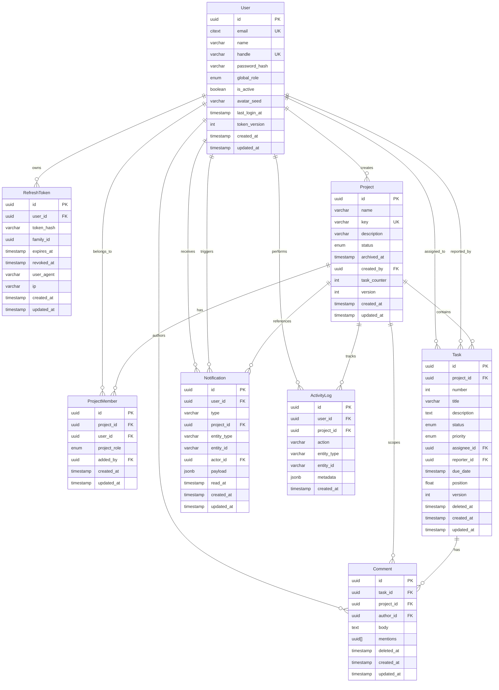

# FORGELINE — Data Model Specification & Schema Design
Last updated: 2026-10-10

---

## 1. Entity Relationship (ER) Diagram

---

## 2. Table-by-Table Architectural Reference

### 2.1 `users`
* **Purpose:** Core user identity, role classification, and authentication security state.
* **Columns:**
  * `id` (`UUID`): Primary key.
  * `email` (`CITEXT`): Case-insensitive unique email address, preventing duplicate registrations differing only by casing (e.g., `User@Domain.com` vs `user@domain.com`).
  * `name` (`VARCHAR(100)`): Display name.
  * `handle` (`VARCHAR(50)`): Unique alphanumeric handle used for `@mentions` in comments.
  * `password_hash` (`VARCHAR(255)`): Argon2id memory-hard hash.
  * `global_role` (`ENUM`): System-wide role (`ADMIN`, `PROJECT_MANAGER`, `TEAM_MEMBER`, `VIEWER`).
  * `is_active` (`BOOLEAN`): Soft deletion/deactivation toggle. When false, logins, token refreshes, and WebSocket sessions are immediately severed.
  * `avatar_seed` (`VARCHAR(100)`): Deterministic seed for procedural avatar totems.
  * `last_login_at` (`TIMESTAMP`): Audit tracking for account activity.
  * `token_version` (`INT`): Invalidation counter. Incrementing this immediately renders all active access JWTs invalid upon password change or deactivation.

### 2.2 `refresh_tokens`
* **Purpose:** Rotating refresh session state with automated token family reuse detection.
* **Columns:**
  * `token_hash` (`VARCHAR(255)`): SHA-256 hash of the cryptographically random token string.
  * `family_id` (`UUID`): Tracks token lineages. If a previously rotated token is re-submitted, the entire family is revoked.
  * `expires_at` (`TIMESTAMP`): Expiration window (7 days).
  * `revoked_at` (`TIMESTAMP`): Null when active; populated upon rotation or logout.

### 2.3 `projects`
* **Purpose:** Core workspace container for collaborative initiatives.
* **Columns:**
  * `key` (`VARCHAR(10)`): Unique short identifier (e.g. `HLX`, `AGS`) prepended to task numbers.
  * `task_counter` (`INT`): Race-safe atomic counter column incremented in database transactions to assign consecutive task numbers (`HLX-1`, `HLX-2`) without race collisions.
  * `version` (`INT`): Concurrency lock for project metadata mutations.

### 2.4 `project_members`
* **Purpose:** Scoped project membership and role assignments.
* **Constraints:** `UNIQUE(project_id, user_id)`.
* **Cap Rule:** Enforces that a member cannot exceed their global role.

### 2.5 `tasks`
* **Purpose:** Core unit of operational work in the forge.
* **Columns:**
  * `number` (`INT`): Per-project sequence number. Combined with `project_id` in `UNIQUE(project_id, number)`.
  * `version` (`INT`): Strict optimistic concurrency lock. Incremented atomically with `UPDATE tasks SET ..., version = version + 1 WHERE id = $1 AND version = $2`.
  * `position` (`FLOAT`): Fractional ordering index for Kanban lanes.
  * `deleted_at` (`TIMESTAMP`): Soft deletion timestamp preserving activity history.

### 2.6 `comments`
* **Purpose:** Task discussion thread with `@mentions` support.
* **Columns:**
  * `mentions` (`UUID[]`): Array of referenced user IDs to trigger targeted notifications.
  * `project_id` (`UUID`): Denormalized from task to allow fast project-level query scoping without deep joins.

### 2.7 `notifications`
* **Purpose:** In-app notification center.
* **Rules:** `actor_id != user_id` (actors are never notified of their own actions). `read_at IS NULL` indicates unread state.

### 2.8 `activity_logs`
* **Purpose:** Immutable audit timeline. Written in the **exact same database transaction** as the triggering mutation.

---

## 3. Indexing Strategy & Performance Rationale

| Index | Target Table | Rationale |
|---|---|---|
| `(project_id, status, position)` | `tasks` | Accelerates Kanban lane queries and drag-and-drop reordering without full table scans. |
| `(assignee_id)` | `tasks` | Powers instant loading of "My Assigned Tasks" across dashboards. |
| `(task_id, created_at)` | `comments` | Ensures chronologically ordered comment feeds render in single-digit milliseconds. |
| `(user_id, read_at, created_at DESC)` | `notifications` | Powers the unread badge counter query (`WHERE user_id = $1 AND read_at IS NULL`) and ordered notification drop-downs. |
| `(project_id, created_at DESC)` | `activity_logs` | Optimizes the real-time project timeline ticker. |
| `(user_id)` | `project_members` | Quickly resolves all projects a user belongs to upon login and authorization checks. |
